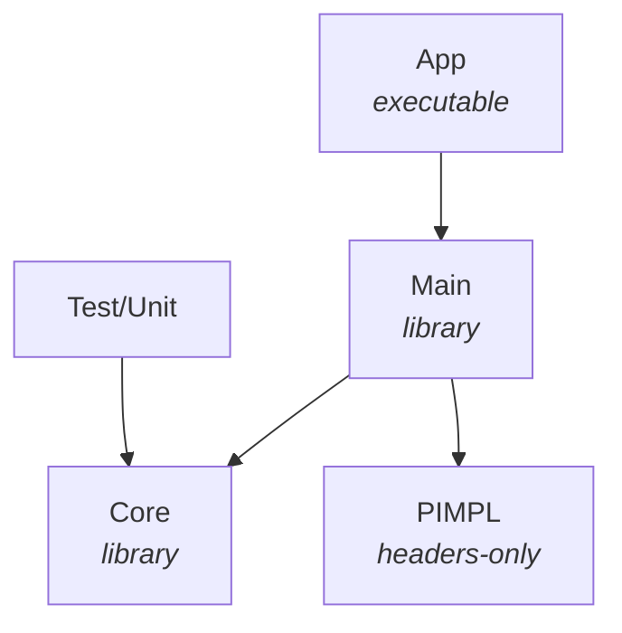

# PhysERD

A desktop counterpart of [dbdiagram.io](https://dbdiagram.io/d/) on Qt/C++: write the database
structure in DBML on the left, see the diagram on the right.

- live diagram while typing; on errors the last valid diagram stays and the errors are underlined
  in the text, listed under it and shown in the gutter;
- tables, columns with settings, indexes, enums, inline and standalone refs (`<`, `>`, `-`, `<>`),
  composite refs, aliases, schemas, `TableGroup`, `TablePartial`, `Project`, sticky notes;
- draggable tables and groups, auto-arrange, zoom and pan, undo of moves, hover highlighting of
  relationships, click on an element to jump to its definition;
- fields shown: all, keys and refs only, table names only; `1/*` labels or crow's foot notation;
- export to PostgreSQL, MySQL, SQL Server, PNG, SVG, PDF and the clipboard;
- import from SQL dumps (`CREATE TABLE`, `CREATE TYPE ... AS ENUM`, `CREATE INDEX`,
  `ALTER TABLE ... ADD`, `COMMENT ON`);
- light and dark themes.

The DBML text is saved as `name.dbml`; the positions of the tables go to `name.layout.json` next to it.

## Requirements

- Qt 5.15 with the modules `core`, `gui`, `widgets`, `svg`, `testlib`;
- qmake;
- C++17.

```
sudo apt install g++ build-essential qtbase5-dev qtbase5-dev-tools qt5-qmake libqt5svg5-dev
```

## Project structure



| Directory | Purpose |
| --- | --- |
| `App` | Entry point: `PhysERD [file.dbml \| dump.sql]` |
| `Core/DTO` | Schema model: tables, columns, indexes, refs, enums, groups, notes |
| `Core/Dbml` | DBML lexer, parser with error recovery, writer |
| `Core/Sql` | SQL export for three dialects, SQL import |
| `Core/Layout` | Table positions, their JSON file, auto-arrange |
| `Main/Diagram` | Graphics scene, view and items of the diagram |
| `Main/Editor` | DBML editor, syntax highlighting, find and replace |
| `Main/Export` | PNG, SVG and PDF rendering |
| `Main/Resources` | Example diagram, DBML reference, icons |
| `Test/Unit` | Unit tests of the parser, SQL export and import, auto-arrange |

## Build

```
cd path/to/PhysERD
mkdir -p build/Desktop-Debug
cd build/Desktop-Debug/
qmake ../../PhysERD.pro -spec linux-g++ CONFIG+=debug
make -j8
../../v/bin/PhysERD
```

All libraries, the application and the tests are built into `v/bin`.

## Tests

```
make check
```

## License

[MIT](LICENSE)
